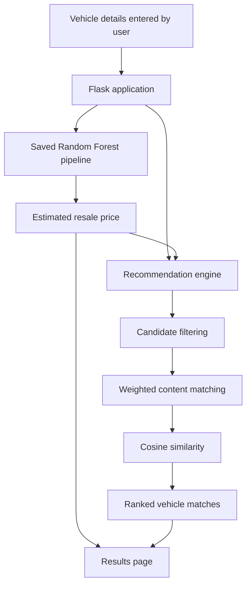

<div align="center">

# ◈ VALUDRIVE
### INTELLIGENT VEHICLE VALUATION & DISCOVERY

**Know the value. Find your next drive.**

A machine-learning web application that estimates used-car resale prices and recommends comparable vehicles — built with Python, Scikit-learn, and Flask.


| **0.851** | **₹80,195** | **3 Models** |
|:---:|:---:|:---:|
| Random Forest R² | Random Forest MAE | Compared & evaluated |

[Overview](#-the-idea) · [How It Works](#-how-it-works) · [Model Results](#-model-performance) · [Recommendation Engine](#-the-recommendation-engine) · [Run Locally](#-run-it-locally)

</div>

---

## ◈ The Idea

Buying or selling a used car comes with two practical questions:

> **What is this car worth — and what else could I get for a similar price?**

ValuDrive brings both answers into one place. Users enter a vehicle's specifications to receive an estimated resale price, compare similar listings, and explore alternative vehicles selected by the recommendation engine.

This is an **estimate based on historical dataset patterns**, not a live-market quote or professional valuation.

## ✦ What Makes ValuDrive Useful?

| Feature | What it does |
|---|---|
| **Price prediction** | Estimates resale value from vehicle attributes |
| **Model comparison** | Evaluates Linear Regression, Decision Tree, and Random Forest |
| **Similar listings** | Finds comparable entries for the same brand and model |
| **Alternative vehicles** | Suggests other models with relevant similarities |
| **Match explanations** | Shows attribute-based reasons behind recommendations |
| **Web interface** | Brings prediction and recommendations together in a Flask app |

## ⌁ How It Works



### 01 / Prepare the data
- Start with the `Car details v3.csv` dataset.
- Remove duplicate records and process missing values.
- Extract brand and model from the vehicle name.
- Clean numerical fields such as mileage and engine capacity.
- Apply median imputation to numerical features, most-frequent imputation to categorical features, and One-Hot Encoding to categorical inputs.

### 02 / Train and evaluate
The target variable is `selling_price`. The dataset is split into **80% training** and **20% testing** data. Three regression algorithms are evaluated using MAE, RMSE, and R².

### 03 / Recommend vehicles
The recommendation engine filters candidate vehicles, calculates weighted attribute matches, incorporates cosine similarity, and returns ranked similar listings and alternatives with readable match reasons.

### 04 / Present the results
Flask connects the saved model and recommendation engine to the website. The user receives the estimated price and vehicle recommendations in one interface.

## ◉ Model Performance

The models were evaluated on the test split. Lower MAE and RMSE are better; higher R² is better.

| Regression model | MAE ↓ | RMSE ↓ | R² ↑ |
|---|---:|---:|---:|
| **Random Forest Regressor** | **₹80,195** | **₹180,544** | **0.851** |
| Decision Tree Regressor | ₹102,677 | ₹249,537 | 0.716 |
| Linear Regression | ₹177,094 | ₹329,462 | 0.505 |

**Selected model: Random Forest Regressor**

- **MAE — ₹80,195:** the mean absolute difference between predicted and actual prices on the test set.
- **RMSE — ₹180,544:** an error metric that penalizes larger prediction errors more heavily.
- **R² — 0.851:** the model explains approximately 85.1% of the variation in selling prices in the test data.

> R² is not the same as “85.1% prediction accuracy.” Actual resale value can also depend on vehicle condition, service history, location, and market demand.

## ⌘ The Recommendation Engine

ValuDrive has two recommendation tracks:

**A / Similar listings**
- Focuses on the same brand and model.
- Prioritizes vehicles with comparable characteristics.

**B / Alternative vehicles**
- Looks for different models.
- Filters by attributes such as year, fuel type, transmission, price range, and seating capacity.

### Hybrid match score

The current implementation combines two signals:

```text
Weighted content matching     85%
Cosine similarity              15%
                              ────
Hybrid match score             100%
```

The score is presented **out of 100 as a relative matching score**, not as the probability that a vehicle is right for the user. The weighting is a design choice and can be tuned through further evaluation.

## ⚙️ Tech Stack

| Layer | Tools |
|---|---|
| Language | Python |
| Data handling | Pandas, NumPy |
| Machine learning | Scikit-learn |
| Web backend | Flask |
| Frontend | HTML, CSS, JavaScript |
| Saved model | Pickle-based model pipeline (`.pkl`) |

## ▦ Project Structure

```text
vehicle-price-prediction-recommendation-system/
├── app.py                    # Flask routes and model integration
├── train_model.py            # Preprocessing, training, evaluation
├── recommendation.py         # Similar listings and alternatives
├── requirements.txt          # Python dependencies
├── model_results.csv         # Model comparison metrics
├── data/
│   └── Car details v3.csv    # Dataset
├── models/
│   ├── price_model.pkl       # Trained prediction pipeline
│   └── model_metadata.pkl    # Feature and dropdown metadata
└── templates/
    └── index.html            # Web interface
```

## ▶ Run It Locally

### 1. Clone the repository

```bash
git clone https://github.com/SurajKrishnen/vehicle-price-prediction-recommendation-system.git
cd vehicle-price-prediction-recommendation-system
```

### 2. Create and activate a virtual environment

**Windows PowerShell**
```powershell
python -m venv .venv
.venv\Scripts\Activate.ps1
```

**macOS / Linux**
```bash
python -m venv .venv
source .venv/bin/activate
```

### 3. Install dependencies

```bash
pip install -r requirements.txt
```

### 4. Launch the application

If the repository already contains the trained model files, start the web app:

```bash
python app.py
```

Then open **http://127.0.0.1:5000** in your browser.

To retrain and regenerate the model artifacts, run:

```bash
python train_model.py
```

## 🧭 Dataset & Limitations

- The project uses `Car details v3.csv`, an Indian used-car dataset.
- Model performance reflects the available dataset and the particular train/test split.
- The model does not currently provide a live marketplace price or inspect vehicle condition.
- Recommendations are based on available vehicle attributes; they do not guarantee the best purchase for every user.
- For reproducibility, use compatible versions of the Python and Scikit-learn dependencies when loading the saved model.

## ⤴ Future Improvements

- Validate model performance with cross-validation and hyperparameter tuning.
- Evaluate recommendations with ranking metrics and user feedback.
- Incorporate vehicle condition, location, and more recent market data.
- Add feature-importance or SHAP-based explanations.
- Deploy the application and add automated tests.

---

<div align="center">

### Built to make used-car decisions more informed.

**VALUDRIVE** · Predict. Compare. Choose Better.

<sub>Academic machine-learning project · Price prediction + vehicle recommendations</sub>

</div>
